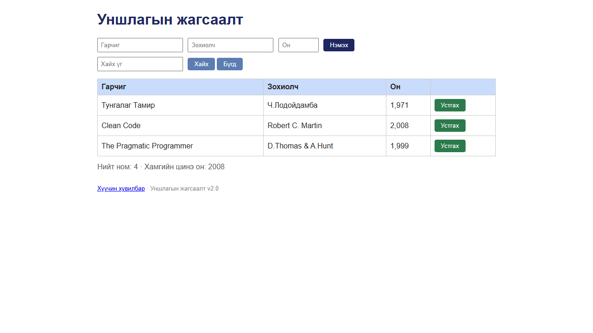

# BUG-01: Нүүр хуудасны «Нийт ном» тоолуур хүснэгтийн мөрийн тооноос үргэлж 1-ээр их байна

Орчин: Уншлагын жагсаалт v2.0, Google Chrome 155 (headless, Playwright), Windows 11, 2026-10-18

Урьдчилсан нөхцөл: `node app.js`-ийг шинээр асаасан (анхны 3 ном: Тунгалаг Тамир, Clean Code, The Pragmatic Programmer)

## Дахин гаргах алхам

1. Хөтөч дээр http://localhost:3000 нээ.
2. Хүснэгтийн мөрийг тоол — 3 мөр.
3. Хүснэгтийн яг доорх «Нийт ном: …» мөрийг уншина.
4. Нэмэлт шалгалт: 3 мөрийн «Устгах» товчийг (эхний мөрийнхийг) гурван удаа дар — хүснэгт хоосон болно.
5. API түвшинд (терминалд, апп-ыг шинээр асаасан үед): `curl -i localhost:3000/api/stats` ба `curl -i localhost:3000/api/books`.

Хүлээгдэж байсан: Спецификацийн 7-р дүрэм — «Нийт ном» тоолуур хүснэгтэд буй номын тоотой тэнцүү. Эхлэхэд «Нийт ном: 3», хүснэгт хоосон болоход «Нийт ном: 0».

Бодит үр дүн: Нүүр хуудас ачаалмагц «Нийт ном: 4 · Хамгийн шинэ он: 2008» гарна, гэтэл хүснэгтэд 3 мөр байна. Тоолуур ямагт мөрийн тооноос 1-ээр их: ном нэмбэл 4 мөрийн дор «5», бүх номыг устгасны дараа хүснэгт хоосон байхад «Нийт ном: 1». API-д `GET /api/stats` → `{"total":4,"newest":2008}`, харин `GET /api/books` → 3 ном.

Ноцтой байдал: Major — тоолуур хуудас нээсэн даруйдаа, ямар ч төлөвт буруу, мөн API (`/api/stats`)-д байгаа тул ямар ч клиентийг төөрөлдүүлнэ. Өгөгдөл алдагдахгүй тул Critical биш.

Хавсралт:  · [evidence/bug-01-curl.txt](../evidence/bug-01-curl.txt)

Олдсон аялал: Supermodel (нүүр хуудсыг анх харахад); Fed-Ex-ээр (UI → `/api/stats`) API түвшинд баталгаажуулсан
