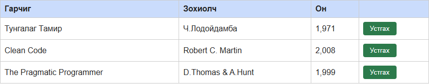

# BUG-02: «Он» баганад он мянгатын таслалтай («1,999») харагдаж байна

Орчин: Уншлагын жагсаалт v2.0, Google Chrome 155 (headless, Playwright), Windows 11, 2026-10-18

Урьдчилсан нөхцөл: `node app.js`-ийг шинээр асаасан (анхны 3 ном)

## Дахин гаргах алхам

1. Хөтөч дээр http://localhost:3000 нээ.
2. Хүснэгтийн «Он» баганын утгуудыг хар.
3. Нэмэлт: Гарчиг `Test Book`, Зохиолч `Tester`, Он `2020` гэж бөглөөд «Нэмэх» товчийг дар — шинэ мөрийн оныг хар.

Хүлээгдэж байсан: Спецификацийн 2-р дүрэм — он хүснэгтэд энгийн тоогоор (жишээ нь 1999) харагдана: `1971`, `2008`, `1999`, `2020`.

Бодит үр дүн: `1,971`, `2,008`, `1,999`; шинээр нэмсэн ном `2,020`. (Хэт том утга ч `99,999,999,999` гэж таслалтай харагдана.) API-д ижил ном `"year":1999` буюу таслалгүй.

Ноцтой байдал: Minor — спецификацийн шууд зөрчил боловч мэдээлэл уншигдахуйц, ажиллагаанд нөлөөгүй. Харин «1,999» нь зарим орон нутгийн тэмдэглэлд аравтын бутархай (1.999) шиг ойлгогдож болно.

Хавсралт: 

Олдсон аялал: Supermodel (GUI)
