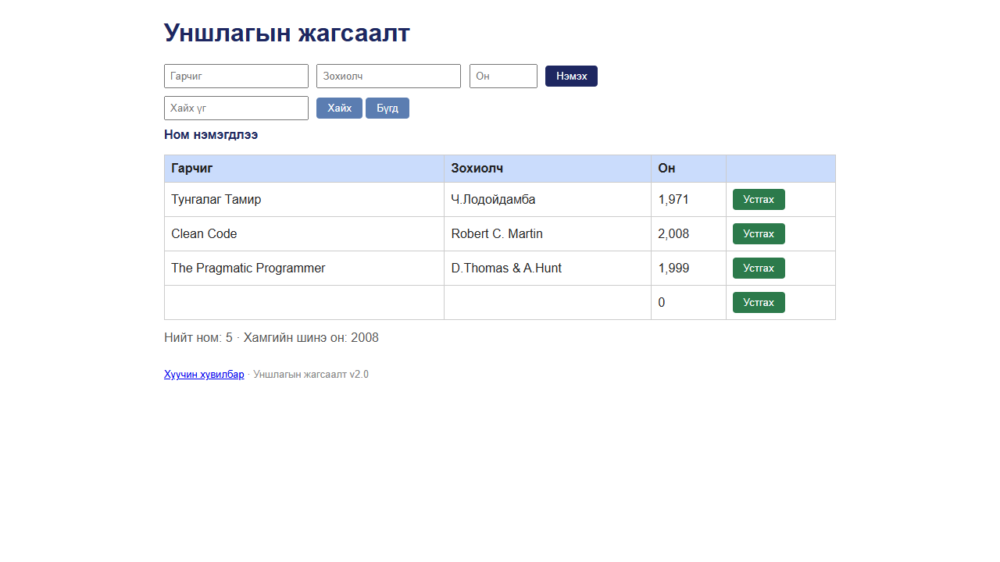

# BUG-06: Гарчиг/Зохиолч/Он талбар хоосон байхад ч ном нэмэгдэж, алдааны мессеж огт гардаггүй

Орчин: Уншлагын жагсаалт v2.0, Google Chrome 155 (headless, Playwright), Windows 11, 2026-10-18

Урьдчилсан нөхцөл: `node app.js`-ийг шинээр асаасан (анхны 3 ном)

## Дахин гаргах алхам

1. Хөтөч дээр http://localhost:3000 нээ.
2. «Гарчиг», «Зохиолч», «Он» гурван талбарыг ХООСОН орхи.
3. «Нэмэх» товчийг дар.
4. Хүснэгтийн доод мөр, хүснэгтийн дээрх мессеж, «Нийт ном» тоолуурыг хар.
5. Хувилбарууд (шинэчилсэн хуудсан дээр тус бүрийг давт): зөвхөн «Гарчиг» = `Only Title`; зөвхөн «Он» = `2000`; «Гарчиг» ба «Зохиолч» = гурван хоосон зай, «Он» = `2000`.
6. API түвшинд (терминалд, апп-ыг шинээр асаасан үед): `curl -i -X POST localhost:3000/api/books -H 'Content-Type: application/json' -d '{}'`.

Хүлээгдэж байсан: Спецификацийн 1-р дүрэм — гурван талбар бүгд заавал бөглөгдсөн байх ёстой; дутуу бол ном нэмэгдэхгүй, ойлгомжтой алдааны мессеж харагдана.

Бодит үр дүн: Хоосон талбартай ч «Ном нэмэгдлээ» мессеж гарч, хүснэгтийн төгсгөлд хоосон гарчиг, хоосон зохиолчтой, оны баганад «0» бүхий мөр нэмэгдэж, «Нийт ном» нэгээр өснө. Ямар ч алдааны мессеж гарахгүй. Дутуу талбартай (зөвхөн гарчиг, зөвхөн он), зөвхөн хоосон зайтай оролтыг ч хүлээн авна. API: `{}` → `HTTP/1.1 201 Created`, `{"result":"OK","id":4}`.

Ноцтой байдал: Major — үндсэн өгөгдлийн бүрэн бүтэн байдал алдагдаж, жагсаалтад хоосон «хог» мөр орно; спецификацийн шууд зөрчил, хэрэглэгч юу буруу болсныг мэдэхгүй.

Хавсралт:  · [evidence/bug-06-curl.txt](../evidence/bug-06-curl.txt)

Олдсон аялал: Couch Potato (хоосон/хамгийн бага оролт)
