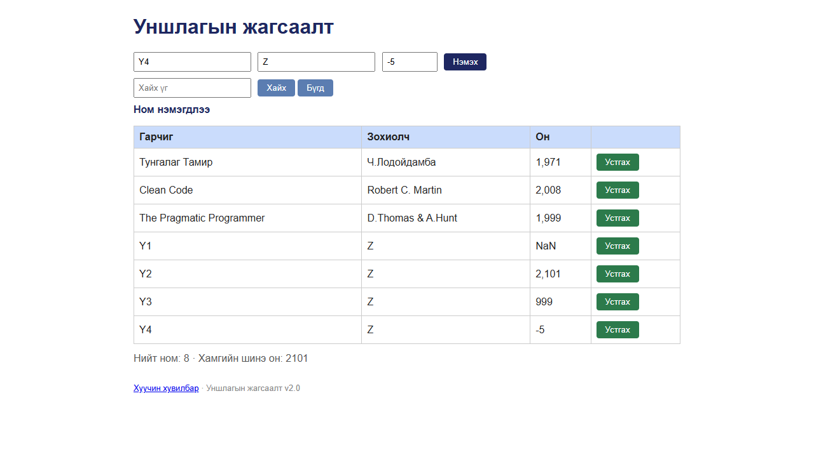

# BUG-07: «Он» талбарын утга шалгагддаггүй — 1000-2100-аас гадуур, бүхэл бус, тоо биш утга («NaN») хүлээн авдаг

Орчин: Уншлагын жагсаалт v2.0, Google Chrome 155 (headless, Playwright), Windows 11, 2026-10-18

Урьдчилсан нөхцөл: `node app.js`-ийг шинээр асаасан (анхны 3 ном)

## Дахин гаргах алхам

**А. UI түвшин**

1. Хөтөч дээр http://localhost:3000 нээ.
2. Гарчиг `Y1`, Зохиолч `Z`, Он `abc` → «Нэмэх».
3. Гарчиг `Y2`, Зохиолч `Z`, Он `2101` → «Нэмэх».
4. Гарчиг `Y3`, Зохиолч `Z`, Он `999` → «Нэмэх».
5. Гарчиг `Y4`, Зохиолч `Z`, Он `-5` → «Нэмэх».
6. Хүснэгтийн доод 4 мөр, мессеж, «Хамгийн шинэ он»-ыг хар.

**Б. Өгөгдлийн түвшин** (апп-ыг дахин асаагаад, хуудсыг шинэчилсэний дараа)

1. Хөтөч дээр Гарчиг `Typed`, Зохиолч `Anon`, Он `2004` → «Нэмэх» (хэвийн, зөв он).
2. Терминалд: `curl -i localhost:3000/api/books` — сүүлийн номын `year`-ийг хар.
3. Терминалд: `curl -i -X POST localhost:3000/api/books -H 'Content-Type: application/json' -d '{"title":"Y","author":"Z","year":"abc"}'`, дараа нь дахин `curl -i localhost:3000/api/books`.

Хүлээгдэж байсан: Спецификацийн 2-р дүрэм — он нь 1000-2100 хоорондох бүхэл тоо. Бусад утга (`abc`, `2101`, `999`, `-5`, `1999.5`) нэмэгдэхгүй, алдааны мессеж гарна. Он нь анхны номуудынх шиг (`1999`) тоон төрлөөр хадгалагдана.

Бодит үр дүн: А — дөрвөн утга бүгд «Ном нэмэгдлээ» гэж хүлээн авагдаж, хүснэгтэд `NaN`, `2,101`, `999`, `-5` гэж харагдана; «Хамгийн шинэ он» 2101 болно. Мөн `1999.5` → `1,999.5`, `99999999999` → `99,999,999,999`, `1e3` → `1,000`, `2000abc` → `NaN`. Б — зөв он (`2004`)-той ч UI-аас нэмсэн номын `year` нь API-д ТЕКСТ (`"year":"2004"`), анхны номуудынх тоо (`"year":1999`); `year:"abc"`-тай POST → `201 Created`, `"year":"abc"` хадгалагдана. (Энэ нь session-ий тэмдэглэлд BUG-13 гэж нэр дэвшсэн, нэг шалтгаантай тул энд нэгтгэв.)

Ноцтой байдал: Major — спецификацийн шууд зөрчил; хүснэгтэд «NaN» гэх мэт утгагүй өгөгдөл гарч, API-ийн оны төрөл холилдсоноос өгөгдлийг боловсруулах бусад систем эвдэрнэ.

Хавсралт:  · [evidence/bug-07-curl.txt](../evidence/bug-07-curl.txt)

Олдсон аялал: Couch Potato (оролтын хязгаарын утгууд); Fed-Ex-ээр (UI → API) он текст болж хадгалагдахыг баталгаажуулсан
