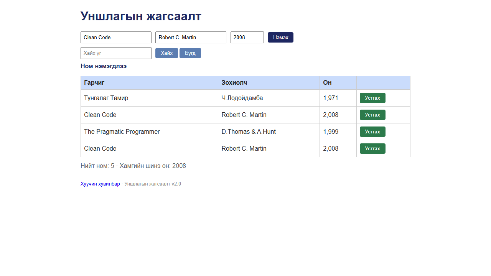

# BUG-08: Ижил гарчиг, зохиолчтой ном давхардаж нэмэгддэг

Орчин: Уншлагын жагсаалт v2.0, Google Chrome 155 (headless, Playwright), Windows 11, 2026-10-18

Урьдчилсан нөхцөл: `node app.js`-ийг шинээр асаасан (анхны 3 ном)

## Дахин гаргах алхам

1. Хөтөч дээр http://localhost:3000 нээ.
2. Гарчиг `Clean Code`, Зохиолч `Robert C. Martin`, Он `2008` гэж бөглө (хүснэгтийн 2-р мөртэй яг ижил).
3. «Нэмэх» товчийг дар.
4. Хүснэгт, мессежийг хар.
5. Нэмэлт: талбарууд бөглөгдсөн хэвээр тул «Нэмэх»-ийг дахин дарахад 3 дахь хуулбар нэмэгдэнэ.

Хүлээгдэж байсан: Спецификацийн 3-р дүрэм — ижил гарчиг, зохиолчтой ном давхардуулж нэмэгдэхгүй (давхардсан тухай мессеж харагдана).

Бодит үр дүн: «Ном нэмэгдлээ» мессеж гарч, хүснэгтэд `Clean Code / Robert C. Martin / 2,008` мөр хоёр болно. Өөрийн нэмсэн ном (`Dup Title` / `Dup Author` / `2000`)-г 2 удаа нэмэхэд ч адил; том/жижиг үсэг (`DUP TITLE` / `dup author`), төгсгөлийн хоосон зай нэмсэн хувилбар ч шинэ мөр болж орно.

Ноцтой байдал: Major — спецификацийн шууд зөрчил, жагсаалт давхардсан өгөгдлөөр бохирдож, «Нийт ном» хэтэрхий өснө.

Хавсралт: 

Олдсон аялал: Fed-Ex (нэмэх → хүснэгт өгөгдлийн зам) + Obsessive-Compulsive (давтан оролт)
