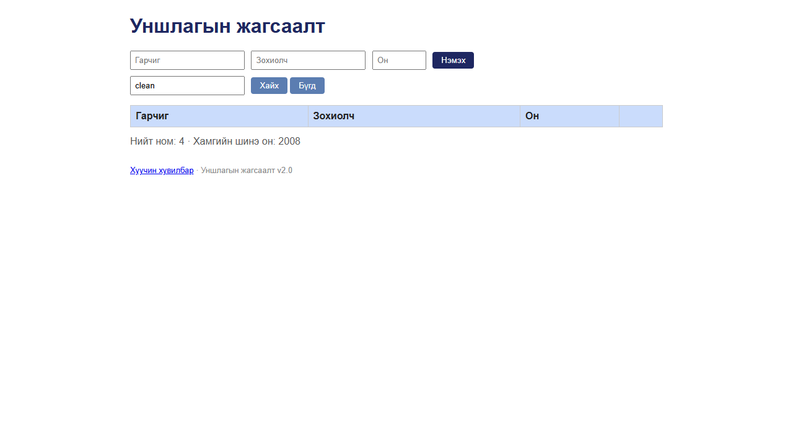

# BUG-09: Хайлт том/жижиг үсгийг ялгадаг — «clean» олдохгүй, «Clean» олдоно

Орчин: Уншлагын жагсаалт v2.0, Google Chrome 155 (headless, Playwright), Windows 11, 2026-10-18

Урьдчилсан нөхцөл: `node app.js`-ийг шинээр асаасан (анхны 3 ном)

## Дахин гаргах алхам

1. Хөтөч дээр http://localhost:3000 нээ.
2. «Хайх үг» талбарт `clean` (жижиг үсгээр) бичээд «Хайх» товчийг дар → хүснэгт хоосон болно.
3. Талбарыг `Clean` болгон солиод «Хайх» дар → `Clean Code` олдоно.
4. Зохиолчоор: `martin` → хоосон, `Martin` → `Clean Code`. Кирилл: `тунгалаг` → хоосон, `Тунгалаг` → `Тунгалаг Тамир`.
5. API түвшинд (терминалд): `curl -i 'localhost:3000/api/books?q=Clean'`, дараа нь `curl -i 'localhost:3000/api/books?q=clean'`.

Хүлээгдэж байсан: Спецификацийн 4-р дүрэм — хайлт гарчиг болон зохиолчоос хайх ба том/жижиг үсэг ЯЛГАХГҮЙ: `clean`, `CLEAN`, `Clean` гурвуулаа `Clean Code`-ыг олно.

Бодит үр дүн: Зөвхөн хүснэгтийн үсгийн хэлбэртэй яг таарсан үг л олдоно. `clean`, `CLEAN`, `martin`, `MARTIN`, `тунгалаг`, `ТУНГАЛАГ` → 0 үр дүн. API-д `?q=Clean` → 1 ном, `?q=clean` → `[]` (сервер талын хайлт). Гарчиг, зохиолчоор хайх нь үсгийн хэлбэр таарвал ажилладаг.

Ноцтой байдал: Major — хэрэглэгч ихэвчлэн жижиг үсгээр бичдэг тул хайлт бараг ашиглагдахгүй; спецификацийн шууд зөрчил.

Хавсралт:  (`clean` → хоосон) · [evidence/bug-09-curl.txt](../evidence/bug-09-curl.txt)

Олдсон аялал: Fed-Ex (нэмэх → хайх → устгах өгөгдлийн зам)
