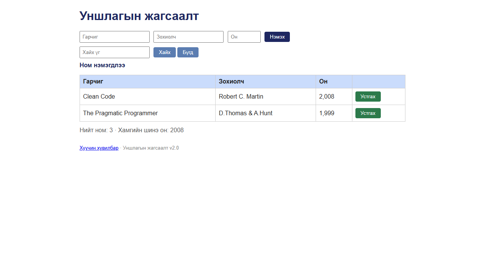

# BUG-10: Ном устгасны дараа «Ном нэмэгдлээ» гэсэн, үйлдэлд нийцэхгүй мессеж гарна

Орчин: Уншлагын жагсаалт v2.0, Google Chrome 155 (headless, Playwright), Windows 11, 2026-10-18

Урьдчилсан нөхцөл: `node app.js`-ийг шинээр асаасан (анхны 3 ном)

## Дахин гаргах алхам

1. Хөтөч дээр http://localhost:3000 нээ. Хайлтын мөр ба хүснэгтийн хоорондох мессежийн талбар хоосон байна.
2. Хүснэгтийн эхний мөр (`Тунгалаг Тамир`)-ийн «Устгах» товчийг дар.
3. Хүснэгт болон хүснэгтийн дээрх мессежийг хар.

Хүлээгдэж байсан: Спецификацийн 5-р дүрэм — үйлдэл бүрийн дараах мессеж тухайн үйлдэлдээ тохирно. Устгасны дараа жишээ нь «Ном устгагдлаа» гэх мэт устгалын мессеж гарна.

Бодит үр дүн: Мөр хүснэгтээс арилдаг, гэвч мессежийн талбарт «Ном нэмэгдлээ» (ном НЭМЭГДСЭН гэсэн утгатай) гарна. Бусад үйлдэл дээр ч мессеж шинэчлэгдэхгүй: «Хайх»/«Бүгд» дарахад өмнөх үйлдлийн мессеж (жишээ нь «Ном нэмэгдлээ») хэвээр үлдэнэ.

Ноцтой байдал: Minor — өгөгдөл зөв устдаг, зөвхөн хэрэглэгчид буруу мэдээлэл өгч төөрөлдүүлнэ; спецификацийн шууд зөрчил.

Хавсралт: 

Олдсон аялал: Fed-Ex (нэмэх → хайх → устгах өгөгдлийн зам)
