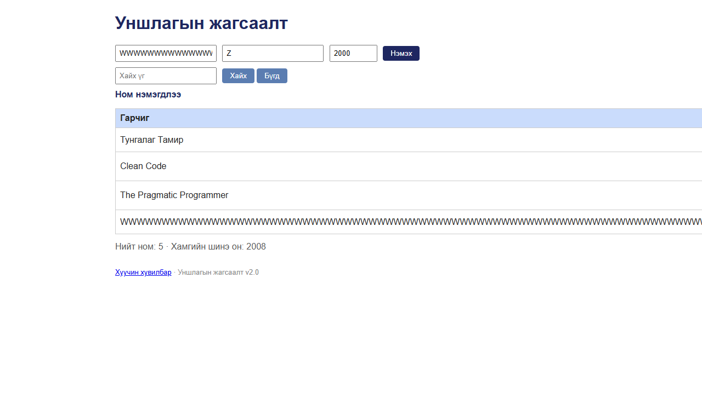

# BUG-11: Зайгүй урт гарчиг нэмэхэд хүснэгт эвдэрч, хуудас хэвтээ гүйлгэгдэж, «Устгах» товч дэлгэцээс гарна

Орчин: Уншлагын жагсаалт v2.0, Google Chrome 155 (headless, Playwright), Windows 11, 2026-10-18; цонхны өргөн 1280px

Урьдчилсан нөхцөл: `node app.js`-ийг шинээр асаасан (анхны 3 ном)

## Дахин гаргах алхам

1. Хөтөч дээр http://localhost:3000 нээ.
2. «Гарчиг» талбарт 120 ширхэг `W` үсгийг зайгүй буулга (хуулж ав):

   ```
   WWWWWWWWWWWWWWWWWWWWWWWWWWWWWWWWWWWWWWWWWWWWWWWWWWWWWWWWWWWWWWWWWWWWWWWWWWWWWWWWWWWWWWWWWWWWWWWWWWWWWWWWWWWWWWWWWWWWWWWW
   ```

3. «Зохиолч» = `Z`, «Он» = `2000` гэж бөглө.
4. «Нэмэх» товчийг дар.
5. Хуудсыг хар; баруун тийш гүйлгэж «Зохиолч», «Он», «Устгах» баганыг хай.

Хүлээгдэж байсан: Спецификацийн 6-р дүрэм — хүснэгт ямар ч урттай оролтод эвдрэхгүй (урт текст мөр шилжинэ, эсвэл таслагдана; бусад багана, «Устгах» товч харагдсаар байна).

Бодит үр дүн: Хүснэгт ~2100px өргөн болж, хуудсанд хэвтээ гүйлгэгч гарч, «Зохиолч», «Он», «Устгах» баганууд дэлгэцээс баруун тийш гарч харагдахаа больно (харагдах хэсэгт зөвхөн «Гарчиг» багана). Хэт урт мөрийг устгах товч нь дэлгэцийн гадна байна. Зайгүй жижиг «a» үсгээр 90 тэмдэгтээс эхлэн (1295px), 120 → 1562px, 150 → 1829px, 300 `W` → 5987px. Зайтай 270 тэмдэгт гарчиг хэвийн мөр шилжинэ.

Ноцтой байдал: Major — нэг л урт оролт бүх хэрэглэгчийн хуудсыг эвдэж (өгөгдөл хуваалцдаг), устгах товчийг гаргаж орхино; спецификацийн шууд зөрчил.

Хавсралт: 

Олдсон аялал: Supermodel (GUI — урт оролт)
