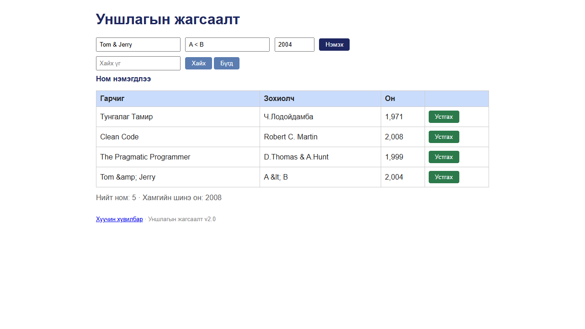

# BUG-12: Гарчиг, зохиолчид оруулсан «&», «<», «>» тэмдэгт серверт escape хийгдэж хадгалагдаад «&amp;», «&lt;» гэж харагдана

Орчин: Уншлагын жагсаалт v2.0, Google Chrome 155 (headless, Playwright), Windows 11, 2026-10-18

Урьдчилсан нөхцөл: `node app.js`-ийг шинээр асаасан (анхны 3 ном)

## Дахин гаргах алхам

1. Хөтөч дээр http://localhost:3000 нээ.
2. Гарчиг `Tom & Jerry`, Зохиолч `A < B`, Он `2004` гэж бөглөөд «Нэмэх» дар.
3. Шинэ мөрийн гарчиг, зохиолчийг хар (3 дахь анхны мөр `D.Thomas & A.Hunt`-тай харьцуул).
4. «Хайх үг» талбарт `Tom & Jerry` гэж бичээд «Хайх» дар.
5. Терминалд: `curl -i localhost:3000/api/books`.

Хүлээгдэж байсан: Эрүүл ухаан / өгөгдлийн бүрэн бүтэн байдал — хэрэглэгчийн бичсэн текст хэвээр харагдаж, хадгалагдана (`Tom & Jerry`, `A < B`). Анхны `D.Thomas & A.Hunt` мөр зөв харагддаг.

Бодит үр дүн: Хүснэгтэд `Tom &amp; Jerry`, `A &lt; B` гэж HTML entity-ийн бичвэр шууд харагдана. API: `"title":"Tom &amp; Jerry"` — сервер хадгалахдаа escape хийдэг. `Tom & Jerry` гэж хайхад 0 үр дүн (хадгалагдсан нь `&amp;` тул), `Tom &` гэхэд олдоно. 25 тэмдэгтийн round-trip шалгалтад зөвхөн `&` → `&amp;`, `<` → `&lt;`, `>` → `&gt;` өөрчлөгдсөн (`&amp;` бичвэл `&amp;amp;` болно); хашилт, `\`, `/`, Кирилл, 日本, эможи хэвээр. (XSS байхгүй — `` ажилласангүй.)

Ноцтой байдал: Major — хэрэглэгчийн өгөгдөл хадгалахад гэмтэж, харагдах текст буруу, хайлтаар өөрийн нэмсэн номоо олохгүй болно.

Хавсралт:  · [evidence/bug-12-curl.txt](../evidence/bug-12-curl.txt)

Олдсон аялал: Fed-Ex (UI → API → хадгалалтын өгөгдлийн зам); Supermodel-ийн тусгай тэмдэгтийн шалгалтаас анх олдсон
