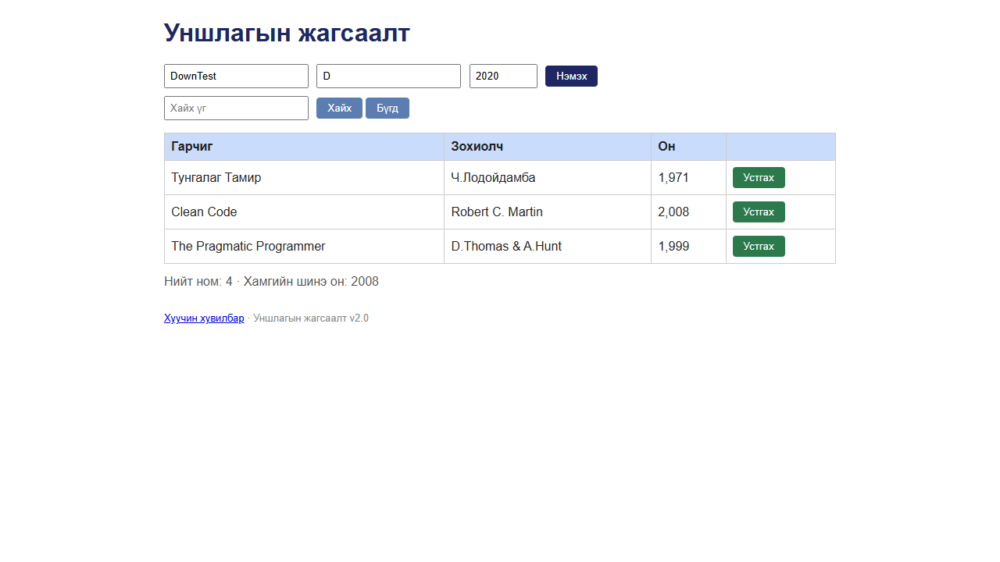

# BUG-16: Сервертэй холбогдож чадахгүй үед «Нэмэх»/«Устгах» дарахад UI ямар ч мессеж харуулалгүй дуугүй бүтэлгүйтдэг

Орчин: Уншлагын жагсаалт v2.0, Google Chrome 155 (headless, Playwright), Windows 11, 2026-10-18

Урьдчилсан нөхцөл: `node app.js`-ийг шинээр асаасан (анхны 3 ном), хөтөч дээр http://localhost:3000 нээлттэй

## Дахин гаргах алхам

1. Хөтөч дээр http://localhost:3000 нээ (хуудсыг ХААЖ ЭСВЭЛ ШИНЭЧЛЭХГҮЙ).
2. `node app.js` ажиллаж буй терминалд `Ctrl+C` дарж серверийг зогсоо.
3. Хөтөчийн хуудсанд Гарчиг `DownTest`, Зохиолч `D`, Он `2020` гэж бөглөөд «Нэмэх» товчийг дар.
4. Эхний мөрийн «Устгах» товчийг дар.
5. Хуудсыг хар; `F12` → Console табыг хар.

Хүлээгдэж байсан: Спецификацийн 5-р дүрэм (үйлдэл бүрийн дараах мессеж тухайн үйлдэлдээ тохирно) ба эрүүл ухаан — үйлдэл амжилтгүй бол «Алдаа: сервертэй холбогдож чадсангүй» шиг ойлгомжтой мессеж харагдана.

Бодит үр дүн: Ямар ч мессеж гарахгүй, хүснэгт өөрчлөгдөхгүй, товч дарсан ч юу ч болоогүй юм шиг харагдана. Зөвхөн Console-д `Failed to load resource: net::ERR_CONNECTION_REFUSED` ба баригдаагүй `TypeError: Failed to fetch` гарна.

Ноцтой байдал: Minor — өгөгдөл алдагдахгүй, гэхдээ хэрэглэгч үйлдэл хийгдсэн эсэхээ мэдэхгүй (BUG-15-ын дараа сервер унахад яг ингэж харагдана).

Хавсралт:  (сервер унтарсны дараа: талбарууд бөглөгдсөн, мессеж алга) · [evidence/bug-16-console.txt](../evidence/bug-16-console.txt)

Олдсон аялал: Saboteur (системийн түвшний довтолгоо — сервер унтраах)
